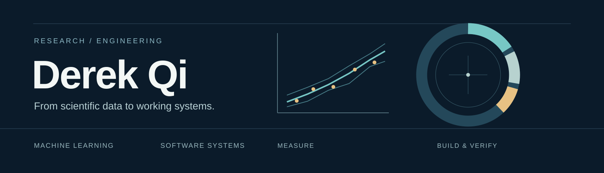

# Derek Qi

Computer Science undergraduate at Liaoning Normal University · [Personal website](https://derekqi.com/)

I work across machine learning and systems, turning questions into software that can be inspected and tested. I care about how results are evaluated, where they fail, and what an implementation actually guarantees.

## Selected work

### [MaterialSense](https://github.com/Derek-Qi/MaterialSense-public)

**Materials data · machine learning · uncertainty**

An AI-assisted research and education project predicting concrete compressive strength from mixture ingredients and curing age.

The study uses the UCI Concrete Compressive Strength dataset (1,030 observations) and groups repeated mixture formulations during evaluation. Across ten recorded grouped resplits, MAE was **4.157 ± 0.609 MPa** and RMSE **5.641 ± 0.788 MPa**. These are split-to-split variations, not confidence intervals or independent material experiments.

Prediction intervals, novelty warnings, ablations and failure cases are documented in the repository. Cross-source assessment is exploratory; the project is **not validated for engineering design**.

### [FAT12 Disk Lab](https://github.com/Derek-Qi/FAT12-Disk-Lab)

**Filesystem internals · verification · local tools**

An AI-assisted educational workbench for inspecting and modifying FAT12 disk images, with a Python engine and local React interface.

The workbench combines allocation analysis, deterministic compaction previews, hash-bound write plans and snapshot-based recovery. In fixed-seed experiments on two ordinary layouts, file extents fell from **33 to 23**, while content and metadata hashes were preserved. This is a layout result, not a disk-speed benchmark. It is a teaching tool, not a complete operating system or a power-fail-safe filesystem.

## Research interests

- **Reliable learning:** grouped evaluation, uncertainty and model behavior under distribution shift
- **Scientific data:** machine learning for materials and physical measurements
- **Human motion:** temporal pose representations and action quality assessment *(exploratory)*
- **Software systems:** inspectable tools, testing and AI-assisted development workflows

## Tools I use

**Research & data**　Python · Streamlit  
**Interfaces & systems**　Python · React  
**Development**　Git · GitHub Actions

I value reproducible experiments, explicit limitations and verifiable implementation. The project links above contain the details and scope of each result.
