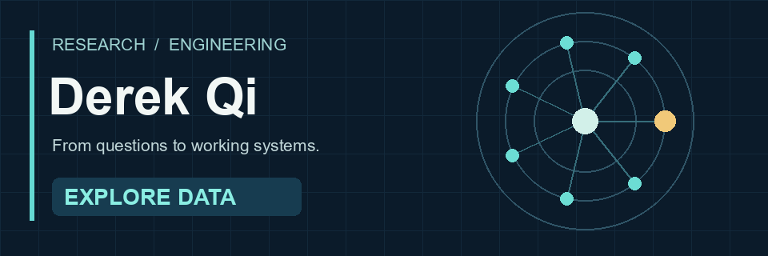
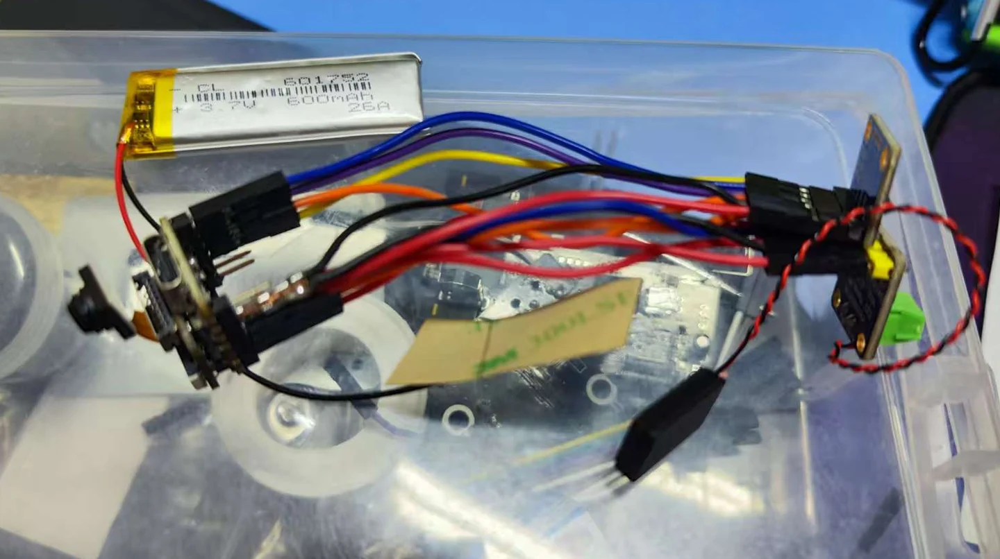

# Derek Qi

Computer Science undergraduate at Liaoning Normal University  
[Personal website](https://derekqi.com/) · [Projects](https://derekqi.com/projects/) · [CV](https://derekqi.com/cv/)

I explore how data, learning systems, and physical prototypes can help people understand and solve practical problems. I care about evaluation, failure cases, and the limits of what a system can actually do.

```python
research_interests = {
    "learning": ["scientific data", "robustness", "uncertainty"],
    "interaction": ["assistive technology", "human-centered systems"],
    "practice": "build, evaluate, and document"
}
```


## Selected publication

[Multimodal Counterfactual Fusion with Causality-Guided Contrastive Learning for Noise-Robust Recommendation](https://doi.org/10.3390/fi18100551) · *Future Internet*, 2026

Fourth author, published as **Derui Qi**. The author statement credits me with validation, investigation, resources, data curation, and writing—review and editing. My work included data and feature preparation, checks of five-seed results and robustness comparisons, literature review, and manuscript review. [Research details](https://derekqi.com/research/)

## Selected work

### [MaterialSense](https://github.com/Derek-Qi/MaterialSense-public)

**Scientific data · machine learning · uncertainty**

An AI-assisted research and education project predicting concrete compressive strength from mixture ingredients and curing age.

[](https://github.com/Derek-Qi/MaterialSense-public)

Using the UCI Concrete dataset (1,030 observations), the evaluation groups repeated mixture formulations. Across ten recorded grouped resplits, MAE was **4.157 ± 0.609 MPa** and RMSE **5.641 ± 0.788 MPa**; these are split-to-split variations, not confidence intervals or independent material experiments.

Prediction intervals, novelty warnings, ablations and failure cases are documented. Cross-source assessment is exploratory; the project is **not validated for engineering design**.

### [Assistive Vision Glasses](https://derekqi.com/projects/zhixing-jingling/)

**Assistive interaction · hardware prototyping · team project**

A student team prototype exploring navigation prompts and object finding for people with visual impairments.

[](https://derekqi.com/projects/zhixing-jingling/)

I assembled and soldered the electronics, reworked a cold solder joint, debugged software–hardware connections, and flashed firmware. Basic functions were demonstrated mainly with recorded-video input. The project has no reported field-study, navigation-reliability or latency benchmark. [Explore the project case study](https://derekqi.com/projects/zhixing-jingling/)

## What I am exploring

- **Reliable learning:** grouped evaluation, uncertainty and model behavior under distribution shift
- **Scientific data:** machine learning for materials and physical measurements
- **Human-centered systems:** accessible interaction and assistive prototypes
- **Human motion:** temporal pose representations and action quality assessment *(exploratory)*

I value reproducible work, clear attribution, and honest limits. The links above provide the evidence and scope behind each project.
